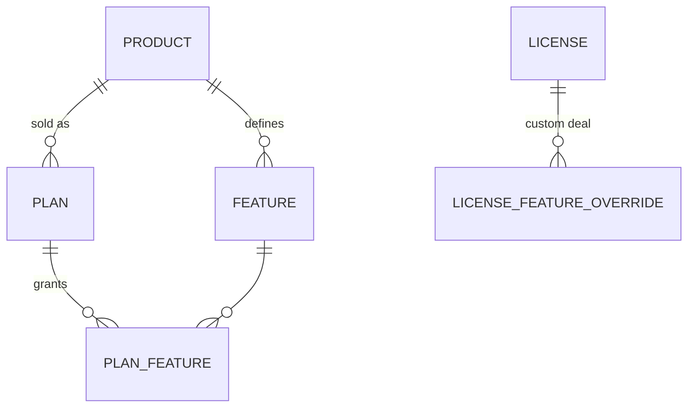

# ADR-0015 Feature catalog per product

*Status: accepted · Date: 2026-11-02*

## Context
Vendors want to define a product, sell it several ways (plans), and control which **features** each customer can use through their license. Entitlements were already planned as free-form JSON on plans (Domain Model). Free-form strings mean typos (`"sso"` vs `"SSO"`), no UI checkboxes, and no way to know which features exist.

## Decision
Features become **first-class objects per product**, in v0.1:



| Entity | Fields |
|---|---|
| **Feature** | `key` (immutable, e.g. `sso`, `max_users`), name, description, `type`: `boolean` or `limit` (integer), optional unit |
| **PlanFeature** | feature + value (`true` / a number, `-1` = unlimited) |
| **License override** | per-license add/remove/change a feature value (enterprise deals) |

- Plans can only reference features defined on their product. API rejects unknown keys.
- At issue, the resolved feature set (plan + overrides) is **snapshotted into the license** ([ADR-0013 License data model hardening](0013-license-data-model-hardening.md)) and signed into the license file's `entitlements`. Format unchanged:
  ```json
  { "features": ["sso", "export"], "limits": { "max_users": 50 } }
  ```
- Adding a feature to a product doesn't change existing licenses; granting it to existing customers is an explicit, audited bulk operation.
- Feature `key` can be archived, never renamed or reused (apps check it by key).
- SDKs: `hasFeature("sso")`, `limit("max_users")`. Unknown key → `false` / `0`, never an error.
- v0.3: the same features are exposed as OpenFeature flags ([ADR-0012 In-cluster license agent](0012-in-cluster-license-agent.md)), so apps already using OpenFeature read license features with no new API.

**Example**
| Feature | Starter | Pro | Enterprise |
|---|---|---|---|
| `export` (boolean) | ✗ | ✓ | ✓ |
| `sso` (boolean) | ✗ | ✗ | ✓ |
| `max_users` (limit) | 5 | 50 | unlimited |

## Scope: license-driven flags, not a feature-flag platform
LicenseForge answers **"is this customer entitled to feature X?"**. It does not do percentage rollouts, A/B tests, user targeting or kill switches; that is LaunchDarkly / Unleash / flagd territory. The OpenFeature provider lets vendors combine both: a flag platform for rollout, LicenseForge for entitlement. ([ADR-0014 Product scope and won't-do list](0014-product-scope-and-won-t-do-list.md))

## Implementation note (2026-11-02)
Tables `features`, `plans`, `plan_features` (`internal/store/schema`), revised after review:
- Feature `key`: immutable snake_case, unique per product including archived features. **Keys, feature types, plan and product slugs, and ownership columns are immutable in the database** (column-level `UPDATE` grants), and features, plans and products are **archived, never deleted** (no `DELETE` grant), because licenses carry keys and slugs: a renamed or recreated one would silently change what old licenses grant.
- Plan term: **calendar months** (`duration_months`, for monthly/yearly billing) **or** whole seconds (`duration_seconds`, trials and fixed periods), at most one; neither = perpetual. Other durations (`lease`, `max_offline`, `grace`) in seconds, ≤ 36,500 days like the license format. `max_activations` / `max_rehosts` ≤ 1,000,000 (null = unlimited).
- `plan_features` carries `feature_type`, checked against the feature through a composite key, with `CHECK ((feature_type = 'limit') = (limit_value IS NOT NULL))`: a boolean feature can't carry a limit and a limit feature always has one (−1 … 2^53−1, −1 = unlimited). A feature in use can't change type.
- All formats and ranges are `CHECK` constraints written in PostgreSQL's normalized form (enum CHECKs are generated from the same value lists as the ent enums); ent validators enforce the same ranges, so users get validation errors rather than database errors. Names can't be blank.
- **Same-tenant, same-product keys**: foreign key checks bypass row-level security, so composite keys stop references to another tenant's or another product's rows, even from the platform pool.
- Guards: a test compares a database built from the ent schema with the migrated one (columns, indexes, CHECK expressions, keys), and a structural test requires every cross-table foreign key to be covered by a `*_same_tenant` key.
- Known, accepted: a foreign-key error can reveal whether another tenant's random ID exists; the API maps both errors to one response.

## Consequences
- Admin UI can show a feature × plan matrix with checkboxes and number fields.
- Typos are caught at plan creation, not in customers' apps.
- Enforcement still happens in the vendor's app; LicenseForge only signs what's allowed.

## Alternatives considered
- **Free-form JSON entitlements** (previous plan): simplest, but no validation or discoverability.
- **Feature bundles / add-ons shared across plans**: useful later ("Security pack" add-on); plans + license overrides cover v0.1.

## Amendment 2026-11-12: archive is reversible
Requested by the maintainer ("soft delete … hidden in the UI, but recoverable"). A product archived by mistake used to retire its slug forever, and apps embedding the slug could never get new licenses.
- **Restore** (`POST …/{products|features|plans|customers}/{id}/restore`) clears `archived_at`. It has the same rights as archive and is audited (`product.restore`, `feature.restore`, `plan.restore`, `customer.restore`). Restoring something that isn't archived answers 409 `invalid_state`.
- After a restore, the row is usable again as before. Licenses already sold were never affected either way.
- Nothing is ever deleted: rows are still archived, never deleted, because licenses carry keys and slugs.
- **Database:** the restrictive policy `archive_once` becomes `archive_or_restore`. An update keeps `archived_at`, sets it from NULL to the database clock (archive), or clears it (restore). It never moves an archived date and never sets a made-up date, and the snapshot match is unchanged.
- **Dashboard:** archived rows stay listed, marked Archived and with a Restore button, for **30 days**. After that they're hidden behind "Show N archived more than 30 days ago", still restorable. The API always lists them with `archived_at` (and `?archived=` where it exists). 30 days is a dashboard constant, not a setting.
