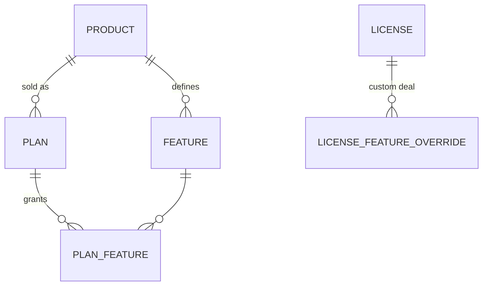

# ADR-0015 Feature catalog per product

*Status: accepted · Date: 2026-11-02*

## Context
Vendors want to define a product, sell it several ways (plans), and control which **features** each customer can use through their license. Entitlements were already planned as free-form JSON on plans (Domain Model). Free-form strings mean typos (`"sso"` vs `"SSO"`), no UI checkboxes, and no way to know which features exist.

## Decision
Features become **first-class objects per product**, in v0.1:



| Entity | Fields |
|---|---|
| **Feature** | `key` (immutable, e.g. `sso`, `max_users`), name, description, `type`: `boolean` or `limit` (integer), optional unit |
| **PlanFeature** | feature + value (`true` / a number, `-1` = unlimited) |
| **License override** | per-license add/remove/change a feature value (enterprise deals) |

- Plans can only reference features defined on their product. API rejects unknown keys.
- At issue, the resolved feature set (plan + overrides) is **snapshotted into the license** ([ADR-0013 License data model hardening](0013-license-data-model-hardening.md)) and signed into the license file's `entitlements`. Format unchanged:
  ```json
  { "features": ["sso", "export"], "limits": { "max_users": 50 } }
  ```
- Adding a feature to a product doesn't change existing licenses; granting it to existing customers is an explicit, audited bulk operation.
- Feature `key` can be archived, never renamed or reused (apps check it by key).
- SDKs: `hasFeature("sso")`, `limit("max_users")`. Unknown key → `false` / `0`, never an error.
- v0.3: the same features are exposed as OpenFeature flags ([ADR-0012 In-cluster license agent](0012-in-cluster-license-agent.md)), so apps already using OpenFeature read license features with no new API.

**Example**
| Feature | Starter | Pro | Enterprise |
|---|---|---|---|
| `export` (boolean) | ✗ | ✓ | ✓ |
| `sso` (boolean) | ✗ | ✗ | ✓ |
| `max_users` (limit) | 5 | 50 | unlimited |

## Scope: license-driven flags, not a feature-flag platform
LicenseForge answers **"is this customer entitled to feature X?"**. It does not do percentage rollouts, A/B tests, user targeting or kill switches; that is LaunchDarkly / Unleash / flagd territory. The OpenFeature provider lets vendors combine both: a flag platform for rollout, LicenseForge for entitlement. ([ADR-0014 Product scope and won't-do list](0014-product-scope-and-won-t-do-list.md))

## Consequences
- Admin UI can show a feature × plan matrix with checkboxes and number fields.
- Typos are caught at plan creation, not in customers' apps.
- Enforcement still happens in the vendor's app; LicenseForge only signs what's allowed.

## Alternatives considered
- **Free-form JSON entitlements** (previous plan): simplest, but no validation or discoverability.
- **Feature bundles / add-ons shared across plans**: useful later ("Security pack" add-on); plans + license overrides cover v0.1.
