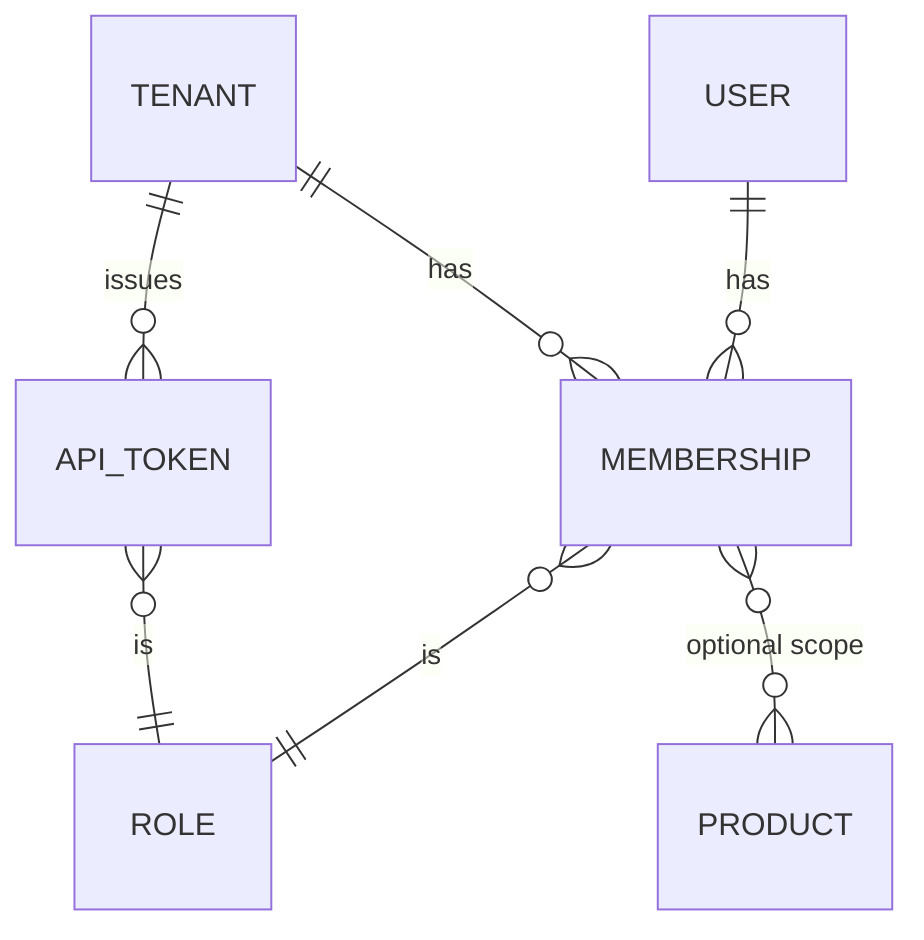

# ADR-0019 Authorization model

*Status: accepted · Date: 2026-11-02*

## Context
Multi-tenant ([ADR-0009 Multi-tenancy](0009-multi-tenancy.md)): a person can belong to several tenants with different rights. IdP roles differ per provider and can't express "admin of tenant A, viewer of tenant B". The hosted operator also needs a platform-level admin.

## Decision
**Tenant-scoped RBAC stored in LicenseForge's database**, enforced in Go, with Postgres RLS as backstop.

### Model

- **User** = `(issuer, sub)` + email/name from claims.
- **Membership** = user × tenant × role, optional **product scope** (e.g. support for product X only).
- **API token** = same roles, plus optional product scope and expiry. Hashed at rest, prefix shown (`lf_live_ab12…`).
- **Invitation** = email + role, accepted by logging in.

### Built-in roles (v0.1, fixed set)
| Role | Can |
|---|---|
| `owner` | Everything, incl. delete tenant, manage signing keys, billing |
| `admin` | Manage products, features, plans, members, tokens, webhooks |
| `manager` | Issue/suspend/revoke licenses, manage customers, offline activations |
| `support` | Read everything, rehost, deactivate machines, reset activations |
| `viewer` | Read-only |
| `sdk` (tokens only) | Activation API only |

Plus a **platform admin** flag (hosted operator: list tenants, suspend tenant, impersonate with audit) outside tenant roles.

### Enforcement
- Permissions are constants in Go (`license:issue`, `plan:write`, `key:rotate`…); roles map to permission sets in code. One `authz.Require(ctx, perm, resource)` call per handler.
- Every request resolves `(principal, tenant)` from session/token; tenant comes from the URL (`/v1/tenants/{tenant}/...`), membership is checked, then `SET LOCAL app.tenant_id` for RLS.
- **Every write goes to the audit log** with principal, tenant, action, before/after.
- Tests: table-driven role × permission test, plus the cross-tenant RLS test from [ADR-0008 Go, PostgreSQL and ent](0008-go-postgresql-and-ent.md).

## Consequences
- Same model for dashboard, API, CLI.
- Works with any IdP; IdP group → role mapping can be added later for SCIM/enterprise.
- Custom roles not in v0.1. Add when a customer needs them (permissions are already granular, so custom roles = a table).

## Alternatives considered
- **IdP roles/groups as source of truth**: inconsistent across IdPs, can't model per-tenant roles well.
- **OpenFGA / SpiceDB / Cedar / OPA**: powerful, but a new service and policy language for a fixed role set. Revisit if we need per-object sharing (e.g. reseller sees only their customers).
